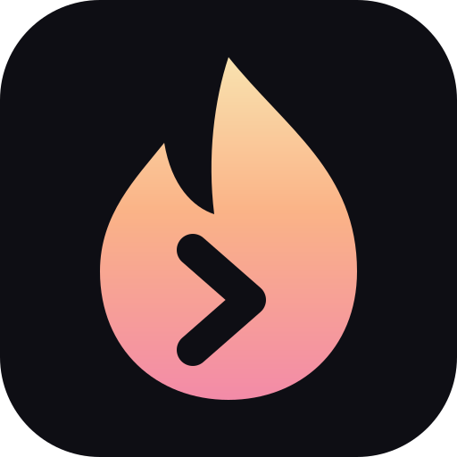

<p align="center"></p>

<h1 align="center">zunder</h1>

<p align="center"><b>One prompt for your apps and your windows.</b><br>A launcher and ALT+TAB window switcher for Hyprland that looks like a terminal.</p>

<p align="center">
  <a href="https://elyesghazel.tech/zunder/">Website</a> ·
  <a href="https://github.com/elyesghazel/zunder/releases/latest">Download</a> ·
  <a href="docs/README.md">Docs</a> ·
  <a href="docs/roadmap.md">Roadmap</a>
  <br><br>
  <a href="https://github.com/elyesghazel/zunder/actions/workflows/ci.yml"></a>
</p>


Most Hyprland setups glue together a launcher, a clipboard script and a separate ALT+TAB tool.
zunder is all of it in one small Rust daemon: one terminal-style prompt for apps, windows, files,
math, currencies, time zones and clipboard history, and an ALT+TAB that shows live thumbnails of
every window on every workspace. Extending it means dropping a script that prints lines into a
folder.

You can [try it in the browser](https://elyesghazel.tech/zunder/) before installing.

## Install

**Linux (Hyprland)**

```sh
curl -fsSL https://raw.githubusercontent.com/elyesghazel/zunder/main/get.sh | sh
```

On Arch it installs the release package, elsewhere the binary goes to `~/.local/bin`. Then
`zunder setup` (or `setup` inside zunder) sets up the keybinds, autostart and theme. If you used
vicinae, rofi or wofi, it takes over from them.

**Windows:** run [zunder-windows-setup.exe](https://github.com/elyesghazel/zunder/releases/latest/download/zunder-windows-setup.exe).
It installs for your user, no admin needed. ALT+SPACE opens zunder.

**macOS (Apple Silicon):** the `.dmg` from the [latest release](https://github.com/elyesghazel/zunder/releases/latest).
Drag it to Applications, then right-click → Open the first time.

New versions show up on zunder's start screen with what changed, and Enter installs them. Type
`update` to check right away, `changelog` for what's new in the version you have. More ways to
install, and what works on which system:
[docs/installation.md](docs/installation.md).

## A quick tour

| Type | You get |
|------|---------|
| `firefox` | windows, apps, files and commands, fuzzy matched |
| `2^10/3` · `100 usd in chf` · `30c` | calculator, currency and unit conversion |
| `3pm ny in zurich` | time zones |
| `clip` | clipboard history; `Ctrl+F` pins an entry for good |
| `> htop` | a shell command |
| `theme` | 12 color schemes, applied live |
| `history` | everything you ever launched |

| Key | Does |
|-----|------|
| `ALT+TAB` | the window switcher, opens on the previous window |
| `SUPER+TAB` | every window by workspace; `Ctrl+W` closes, `Ctrl+1…9` moves |
| `Ctrl+K` | everything you can do with a result: open folder, copy path, close window… |
| `Ctrl+F` | pin any result to the start screen |
| `Ctrl+B` | give any result its own global shortcut |
| `Ctrl+,` | settings |

The rest is in [docs/usage.md](docs/usage.md).

## Plugins

A plugin is any executable in `~/.config/zunder/plugins/` that prints lines:

```sh
#!/bin/sh
# @zunder.name   Notes
# @zunder.prefix note
grep -ri -- "$1" ~/notes | head -50
```

Now `note groceries` searches your notes. Print JSON lines instead for titles, icons and actions.
See [docs/plugins.md](docs/plugins.md).

## Docs

- [Installation](docs/installation.md): every way to install, and what works on Linux, macOS and Windows
- [Setup](docs/setup.md): keybinds, autostart, clipboard, moving over from another launcher
- [Usage](docs/usage.md): every feature, key and command
- [Configuration](docs/configuration.md) and [themes](docs/themes.md): settings, `config.toml`, CSS
- [Plugins](docs/plugins.md): writing your own, in any language
- [Troubleshooting](docs/troubleshooting.md)
- [Development](docs/development.md): how it works inside, building from source, releasing
- [Roadmap](docs/roadmap.md): what's done and what's next

## Some notes

zunder is built for Hyprland first. The launcher, themes, plugins and tray icon also work on
macOS and Windows. The ALT+TAB switcher stays Linux-only, because both of those already have
their own.

Written in Rust with GTK4. Bug reports and small fixes are welcome; for bigger ideas, open an
issue first.

## License

MIT, see [LICENSE](LICENSE).
