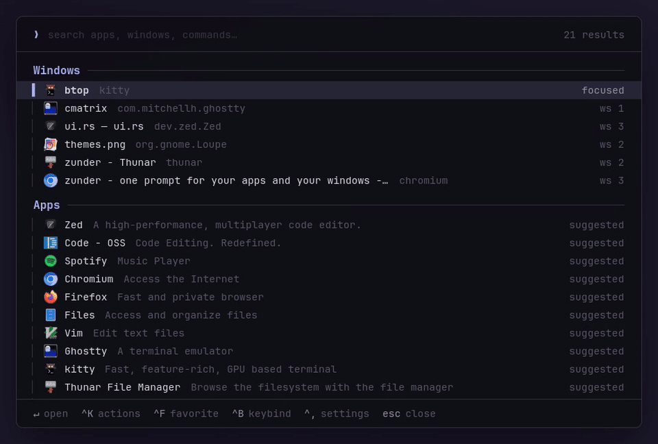
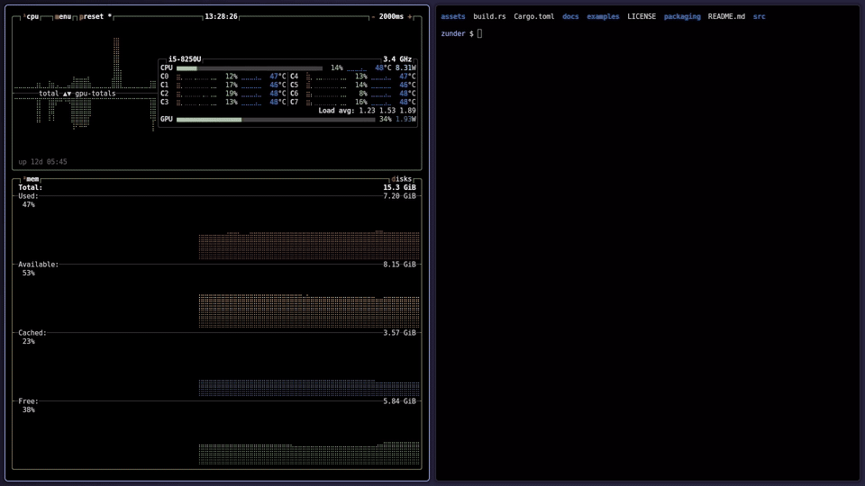

<a id="readme-top"></a>

<div align="center">


<h1>zunder</h1>

<p><b>One prompt for your apps and your windows.</b><br>A launcher and ALT+TAB window switcher for Hyprland that looks like a terminal.</p>

<p>
  <a href="https://github.com/elyesghazel/zunder/actions/workflows/ci.yml"></a>
  <a href="https://github.com/elyesghazel/zunder/releases/latest"></a>
  <a href="https://github.com/elyesghazel/zunder/releases"></a>
  <a href="https://github.com/elyesghazel/zunder/blob/main/LICENSE"></a>
  <br>
  <a href="https://www.rust-lang.org"></a>
  <a href="https://gtk.org"></a>
  <a href="https://hyprland.org"></a>
  
  <a href="https://github.com/elyesghazel/zunder/stargazers"></a>
</p>

<p><a href="https://elyesghazel.tech/zunder/"><b>Website</b></a> · <a href="https://github.com/elyesghazel/zunder/releases/latest"><b>Download</b></a> · <a href="docs/README.md"><b>Docs</b></a> · <a href="https://github.com/elyesghazel/zunder-plugins"><b>Plugins</b></a> · <a href="docs/roadmap.md"><b>Roadmap</b></a></p>

<a href="https://ko-fi.com/elyesghazel"></a>

</div>

---



**zunder is a launcher, an ALT+TAB switcher and a clipboard history in one small Rust daemon.**

Made for Hyprland users who glue together rofi or wofi, a separate ALT+TAB tool and a clipboard script.

- **Launcher:** apps, windows, files and commands in one terminal-style prompt, fuzzy matched
- **ALT+TAB:** a grid with live thumbnails of every window on every workspace
- **Quick answers:** math, units, currencies and time zones (`2^10/3`, `100 usd in chf`, `3pm ny in zurich`)
- **Clipboard history:** type `clip`, pin what you want to keep
- **Themes:** 13 color schemes, switched live with `theme`
- **Plugins and sync:** any script that prints lines is a plugin, and settings sync through a private GitHub gist



You can [try it in the browser](https://elyesghazel.tech/zunder/) before installing.

## Install

```sh
curl -fsSL https://raw.githubusercontent.com/elyesghazel/zunder/main/get.sh | sh
```

On Arch it installs the release package, elsewhere the binary goes to `~/.local/bin`. Then
`zunder setup` (or `setup` inside zunder) sets up the keybinds, autostart and theme. If you used
vicinae, rofi or wofi, it takes over from them.

New versions show up on zunder's start screen, and Enter installs them (Ctrl+K shows what's new).
Type `update` to check right away, `changelog` for every release and what changed.

**Windows and macOS** get the launcher, themes and plugins, without the window switcher.

- Windows: [zunder-windows-setup.exe](https://github.com/elyesghazel/zunder/releases/latest/download/zunder-windows-setup.exe), no admin needed, ALT+SPACE opens it. The builds aren't signed yet, so SmartScreen may warn: More info, then Run anyway.
- macOS (Apple Silicon): the `.dmg` from the [latest release](https://github.com/elyesghazel/zunder/releases/latest). Drag it to Applications, then right-click, Open the first time.

More ways to install, and what works on which system: [docs/installation.md](docs/installation.md).

## A quick tour

| Type | You get |
|------|---------|
| `firefox` | windows, apps, files and commands, fuzzy matched |
| `2^10/3` · `100 usd in chf` · `30c` | calculator, currency and unit conversion |
| `3pm ny in zurich` | time zones |
| `clip` | clipboard history; `Ctrl+F` pins an entry for good |
| `> htop` | a shell command |
| `theme` | 13 color schemes, applied live |
| `history` | everything you ever launched |

| Key | Does |
|-----|------|
| `ALT+TAB` | the window switcher, opens on the previous window |
| `SUPER+TAB` | every window by workspace; `Ctrl+W` closes, `Ctrl+1…9` moves |
| `Ctrl+K` | everything you can do with a result: open folder, copy path, close window… |
| `Ctrl+F` | pin any result to the start screen |
| `Ctrl+B` | give any result its own global shortcut |
| `Ctrl+,` | settings |

The rest is in [docs/usage.md](docs/usage.md).

## Plugins

A plugin is any executable in `~/.config/zunder/plugins/` that prints lines:

```sh
#!/bin/sh
# @zunder.name   Notes
# @zunder.prefix note
grep -ri -- "$1" ~/notes | head -50
```

Now `note groceries` searches your notes. Print JSON lines instead for titles, icons and actions.
See [docs/plugins.md](docs/plugins.md).

Ready-made ones (wifi, bluetooth, audio, pass, github, screenshot, systemd and more) are in
[zunder-plugins](https://github.com/elyesghazel/zunder-plugins):

```sh
zunder plugin search
zunder plugin install wifi
```

## Docs

- [Installation](docs/installation.md): every way to install, and what works on Linux, macOS and Windows
- [Setup](docs/setup.md): keybinds, autostart, clipboard, moving over from another launcher
- [Usage](docs/usage.md): every feature, key and command
- [Configuration](docs/configuration.md) and [themes](docs/themes.md): settings, `config.toml`, CSS
- [Plugins](docs/plugins.md): writing your own, in any language
- [Code signing policy](docs/code-signing.md): how Windows builds are signed, and what zunder sends over the network
- [Troubleshooting](docs/troubleshooting.md)
- [Development](docs/development.md): how it works inside, building from source, releasing
- [Roadmap](docs/roadmap.md): what's done and what's next

## Some notes

zunder is built for Hyprland first. The launcher, themes, plugins and tray icon also work on
macOS and Windows. The ALT+TAB switcher stays Linux-only, because both of those already have
their own.

Written in Rust with GTK4. Bug reports and small fixes are welcome; for bigger ideas, open an
issue first.

## Support

If zunder saves you time, you can [buy me a coffee on Ko-fi](https://ko-fi.com/elyesghazel). Bug reports, ideas and
pull requests are just as welcome: [open an issue](https://github.com/elyesghazel/zunder/issues/new).

## Star history

<a href="https://star-history.com/#elyesghazel/zunder&Date">
  <picture>
    <source media="(prefers-color-scheme: dark)" srcset="https://api.star-history.com/svg?repos=elyesghazel/zunder&type=Date&theme=dark">
    
  </picture>
</a>

## License

MIT, see [LICENSE](LICENSE).

<div align="right"><a href="#readme-top">back to top ↑</a></div>
