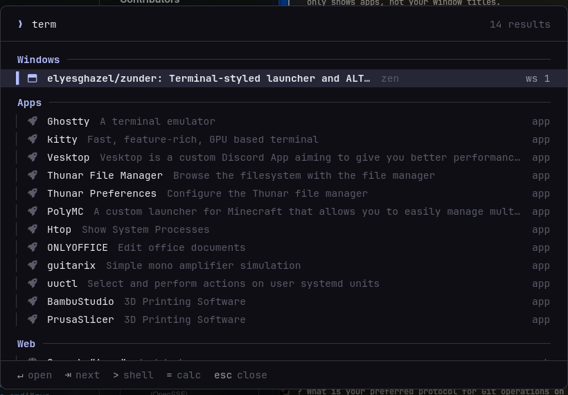
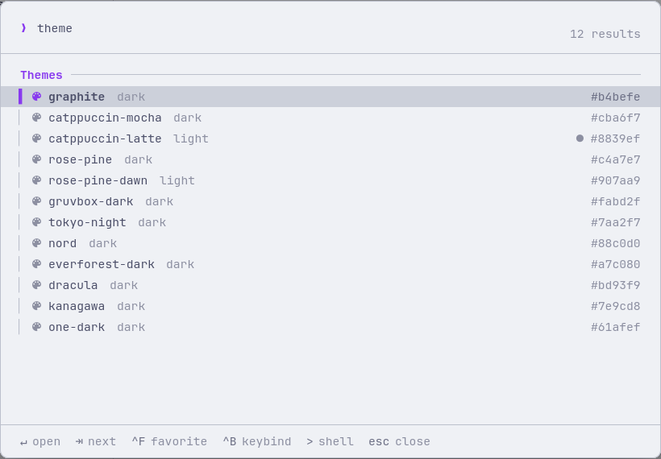

# zunder

A launcher and ALT+TAB window switcher for Hyprland that looks like a terminal.



zunder runs as a small daemon. A keybind sends it a command over a unix socket, and it shows a
layer-shell overlay on top of everything: one prompt, results grouped in sections, monospace,
colored app icons. Open windows, apps, a calculator, a world clock, clipboard history, shell
commands, power actions and your own scripts all live in the same list.

ALT+TAB shows a live screenshot of each window, even ones on other workspaces. Anything in the
list can be pinned to the start screen or get its own global shortcut, and everything you launch
is kept in a history that never gets cleared. Plugins are executables that print lines, so you
can write them in whatever language you like.

Written in Rust with GTK4 and gtk4-layer-shell. Built and tested on Arch with Hyprland 0.56
(Lua config); the classic `hyprland.conf` works too.

**Docs:** [installation](docs/installation.md) · [setup](docs/setup.md) ·
[usage](docs/usage.md) · [configuration](docs/configuration.md) · [plugins](docs/plugins.md) ·
[development](docs/development.md) · [troubleshooting](docs/troubleshooting.md)

## Features

| | |
|---|---|
| **Window switcher** | ALT+TAB with app icons and a live preview of the selected window, any workspace |
| **App launcher** | every `.desktop` app (flatpak too), fuzzy matched on name, keywords and binary |
| **Start screen** | favorites, open windows, your most used apps, suggestions so it's never empty |
| **Favorites** | `Ctrl+F` pins any result to the start screen |
| **Global shortcuts** | `Ctrl+B` gives any result a system-wide Hyprland keybind |
| **Launch history** | `history`: everything you ever ran, searchable, never cleared |
| **World clock** | `time in ny`, `time in 2h in tokyo`, `3pm ny in zurich` |
| **Calculator** | `2^10/3`, `sqrt(2)*pi`, Enter copies |
| **Clipboard** | `clip`: cliphist history with fuzzy search, images too |
| **Shell** | `> cmd` runs in your terminal or in the background |
| **System** | lock, suspend, reboot, shut down, log out |
| **Web search** | fallback for anything, engine of your choice |
| **Plugins** | any script that prints lines, e.g. `kill zen` |
| **Themes** | 12 built in (catppuccin, rose-pine, gruvbox, tokyo-night, nord…), or your own |
| **Settings** | a settings window with a sidebar, plus `settings` inside the launcher |

## Install

### Arch Linux

Prebuilt package from the [latest release](https://github.com/elyesghazel/zunder/releases):

```sh
sudo pacman -U https://github.com/elyesghazel/zunder/releases/download/v0.1.0/zunder-0.1.0-1-x86_64.pkg.tar.zst
sudo pacman -S --needed grim cliphist ttf-jetbrains-mono-nerd   # previews, clipboard, font
```

Or build the package yourself from the [PKGBUILD](packaging/arch/PKGBUILD):

```sh
git clone https://github.com/elyesghazel/zunder
cd zunder/packaging/arch && makepkg -si
```

### Other distros

You need GTK 4.14+ and gtk4-layer-shell from your distro (Fedora: `gtk4 gtk4-layer-shell`).
Then use the release tarball:

```sh
curl -LO https://github.com/elyesghazel/zunder/releases/download/v0.1.0/zunder-0.1.0-x86_64-linux.tar.gz
tar xf zunder-0.1.0-x86_64-linux.tar.gz && cd zunder-0.1.0
./install.sh --plugins
```

### From source

```sh
sudo pacman -S --needed rust gtk4 gtk4-layer-shell wl-clipboard ttf-jetbrains-mono-nerd grim cliphist
git clone https://github.com/elyesghazel/zunder
cd zunder
./install.sh --plugins      # cargo build --release, copies to ~/.local/bin, links example plugins
```

| Dependency | For | Required |
|------------|-----|----------|
| `gtk4` 4.14+, `gtk4-layer-shell` | the UI | yes |
| `wl-clipboard` | copying results | yes |
| a Nerd Font | glyphs, default font | recommended |
| `grim` 1.5+ | window previews | no |
| `cliphist` | clipboard history | no |

More in [docs/installation.md](docs/installation.md), including updating and uninstalling.

## Setup

Start the daemon with Hyprland and bind the keys. With a Lua config:

```lua
-- conf/autostart.lua, inside hl.on("hyprland.start", function() … end)
hl.exec_cmd("zunder server")
hl.exec_cmd("wl-paste --type text --watch cliphist store")    -- clipboard history

-- conf/binds.lua
hl.bind("ALT + TAB",         hl.dsp.exec_cmd("zunder switch"))
hl.bind("ALT + SHIFT + TAB", hl.dsp.exec_cmd("zunder switch-prev"))
hl.bind("ALT + SPACE",       hl.dsp.exec_cmd("zunder toggle"))
hl.bind("SUPER + V",         hl.dsp.exec_cmd("zunder show 'clip '"))

-- conf/windowrules.lua: settings window floats
hl.window_rule({ name = "zunder-settings", match = { title = "^zunder settings$" },
                 float = true, size = "980 660", center = true })

-- hyprland.lua, after your binds: the shortcuts you make with Ctrl+B
pcall(require, "zunder")
```

With a classic `hyprland.conf`:

```ini
exec-once = zunder server
exec-once = wl-paste --type text --watch cliphist store
bind = ALT, TAB, exec, zunder switch
bind = ALT SHIFT, TAB, exec, zunder switch-prev
bind = ALT, SPACE, exec, zunder toggle
bind = SUPER, V, exec, zunder show 'clip '
windowrule = float, title:^zunder settings$
source = ~/.config/hypr/zunder.conf
```

Then `hyprctl reload`, start `zunder server` once by hand (or log out and in) and press
ALT+SPACE. [docs/setup.md](docs/setup.md) has more binds and notes for moving over from vicinae,
rofi or wofi.

## Usage

### Keys

| Key | What it does |
|-----|--------------|
| `ALT+TAB` | switcher, opens on the previous window |
| `Tab` while holding Alt | next window, `ALT+SHIFT+TAB` goes back |
| release Alt | switch to the selected window |
| `↑` `↓` / `Tab` `Shift+Tab` / `Ctrl+J` `Ctrl+K` / `Ctrl+N` `Ctrl+P` | move |
| `Enter` or click | run the selected result |
| `Ctrl+F` | add to / remove from favorites |
| `Ctrl+B` | global shortcut: press the keys, `⌫` removes it, `Esc` cancels |
| `Esc` or click outside | close |

Typing something after ALT+TAB turns it into a search; releasing Alt then doesn't switch.

### What you can type

| Type | You get |
|------|---------|
| nothing | favorites, open windows, recent and suggested apps |
| `firefox` | windows, apps, commands and plugins, best section first |
| `2^10/3`, `sqrt(2)*pi`, `(4+4)*12%5` | calculator, Enter copies |
| `time in ny`, `tokyo time` | the time there, UTC offset, how far ahead or behind you |
| `time in 2h in london`, `in 90 min in la` | the time there, later |
| `3pm in ny`, `9am tokyo`, `3pm ny in zurich` | convert between places |
| `clip`, `clip ssh` | clipboard history, Enter copies again |
| `history`, `history firefox` | everything you ran from zunder, newest first |
| `> htop` | run in your terminal or in the background |
| `theme` | pick a color scheme, applies live |
| `settings` | quick settings; the window is `zunder settings` |
| `kill zen` | a plugin, `<prefix> <query>` |
| anything | web search as the last result |

### Commands

```sh
zunder                  # toggle; starts the daemon first if it isn't running
zunder server           # run the daemon (autostart)
zunder toggle           # show / hide
zunder show [query]     # show, optionally with the query typed, e.g. zunder show 'time in '
zunder hide
zunder switch           # window switcher, or the next window if it's open
zunder switch-prev      # same, backwards
zunder settings [page]  # settings window, e.g. zunder settings appearance
zunder reload           # reread config.toml, rescan apps and plugins
zunder run <key>        # run a saved shortcut (the generated binds call this)
zunder quit             # stop the daemon
zunder --version
```

Every detail is in [docs/usage.md](docs/usage.md).

## Settings

`zunder settings` opens the settings window: pages in a sidebar on the left, the settings on the
right. Changes save right away and most apply immediately.

| Page | What's on it |
|------|--------------|
| General | terminal, web search engine |
| Switcher | release Alt to switch, window previews |
| Start screen | show windows, number of apps |
| Appearance | icons, font, size, theme, accent, backdrop dim, width, height |
| Providers | turn whole sections on or off (Web, System, Clipboard…) |
| Favorites | everything you pinned, with remove buttons |
| Shortcuts | every global shortcut, with remove buttons |
| Plugins | installed plugins and how to call them |
| About | version, open config.toml and style.css |

Everything is stored in `~/.config/zunder/config.toml`, which you can edit by hand too
(`zunder reload` afterwards):

```toml
theme = "rose-pine"
terminal = "ghostty"
search_url = "https://www.google.com/search?q={q}"
font = "JetBrainsMono Nerd Font"
font_size = 11.0
previews = true
alt_release = true
start_apps = 24
disabled = ["Web"]
```

The full reference, every file zunder writes and the CSS selectors are in
[docs/configuration.md](docs/configuration.md).

## Themes



Type `theme` to list the color schemes. `Enter` applies one right away and keeps the list open,
so you can step through them. The Theme dropdown in the settings (or `theme = "nord"` in
`config.toml`) does the same.

Built in: `graphite` (the default), `catppuccin-mocha`, `catppuccin-latte` (light), `rose-pine`,
`rose-pine-dawn` (light), `gruvbox-dark`, `tokyo-night`, `nord`, `everforest-dark`, `dracula`,
`kanagawa` and `one-dark`.

Your own theme is a file in `~/.config/zunder/themes/`, named after the theme, with one
`@define-color` line per color. It shows up in the list next to the built-ins, and a file with a
built-in's name replaces that built-in. Colors you leave out stay graphite.

```css
/* ~/.config/zunder/themes/solarized.css */
@define-color bg     #002b36;
@define-color fg     #eee8d5;
@define-color muted  #93a1a1;
@define-color faint  #657b83;
@define-color ghost  #2a4a54;
@define-color accent #b58900;
@define-color green  #859900;
@define-color sel    #0d3a46;
@define-color hover  #07323d;
```

| Color | Used for |
|-------|----------|
| `bg` | backgrounds |
| `fg` | titles and the query |
| `muted` | key hints, selected hint |
| `faint` | subtitles, placeholder, glyphs |
| `ghost` | borders, separators, row markers |
| `accent` | prompt, section titles, selection |
| `green` | not used by the built-in CSS, there for your own rules |
| `sel` / `hover` | selected / hovered row |

The `accent` setting wins over the theme's accent. For anything beyond colors,
`~/.config/zunder/style.css` loads on top of everything; see
[docs/configuration.md](docs/configuration.md#css) for the selectors.

## Plugins

A plugin is any executable in `~/.config/zunder/plugins/`. Header comments configure it, and
every line it prints is a result:

```sh
#!/bin/sh
# @zunder.name   Notes
# @zunder.prefix note
# @zunder.glyph  
grep -ri -- "$1" ~/notes | head -50        # plain lines: Enter copies them
```

Typing `note groceries` runs `script "groceries"` in the background on each keystroke. For more
control, print JSON lines:

```json
{"title": "zen-bin", "subtitle": "pid 4242", "hint": "6%", "action": {"run": "kill 4242"}}
```

Actions: `run`, `term`, `open`, `copy`, `focus` and `fill`. Plugins in `command` mode show up
in normal search and run once. Plugin results can be favorites and get shortcuts like anything
else.

Two examples come with it, in [`examples/plugins`](examples/plugins): `kill` (search processes,
Enter kills) and `ip` (copy your local IP). [docs/plugins.md](docs/plugins.md) has the whole
format and more examples: GitHub repos, quicklinks, menus.

## How it works

```
keybind ─► zunder switch ─► $XDG_RUNTIME_DIR/zunder.sock ─► daemon
                                                              │
                     hyprctl clients -j ◄─────────────────────┤ on open
                     .desktop files     ◄─────────────────────┤
                     grim -T <window>   ◄─────────────────────┘ ALT+TAB only, in threads
```

The daemon keeps GTK and the app index loaded, so opening is instant; the CLI only writes a word
to the socket. The overlay is a full-screen layer-shell surface with exclusive keyboard focus.
Results come from providers, one Rust file each in `src/providers/`, and adding one is about 30
lines. See [docs/development.md](docs/development.md).

## Roadmap

- emoji and symbol picker
- file search (fd / plocate)
- quicklinks with a `{query}` placeholder, as a built-in
- secondary actions on `Ctrl+Enter` (copy path, open in terminal…)
- paste right away after picking a clipboard entry
- AUR package

## License

MIT, see [LICENSE](LICENSE).
